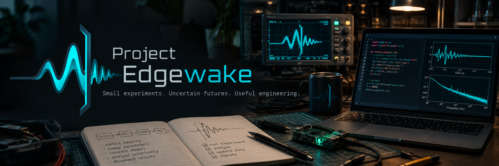
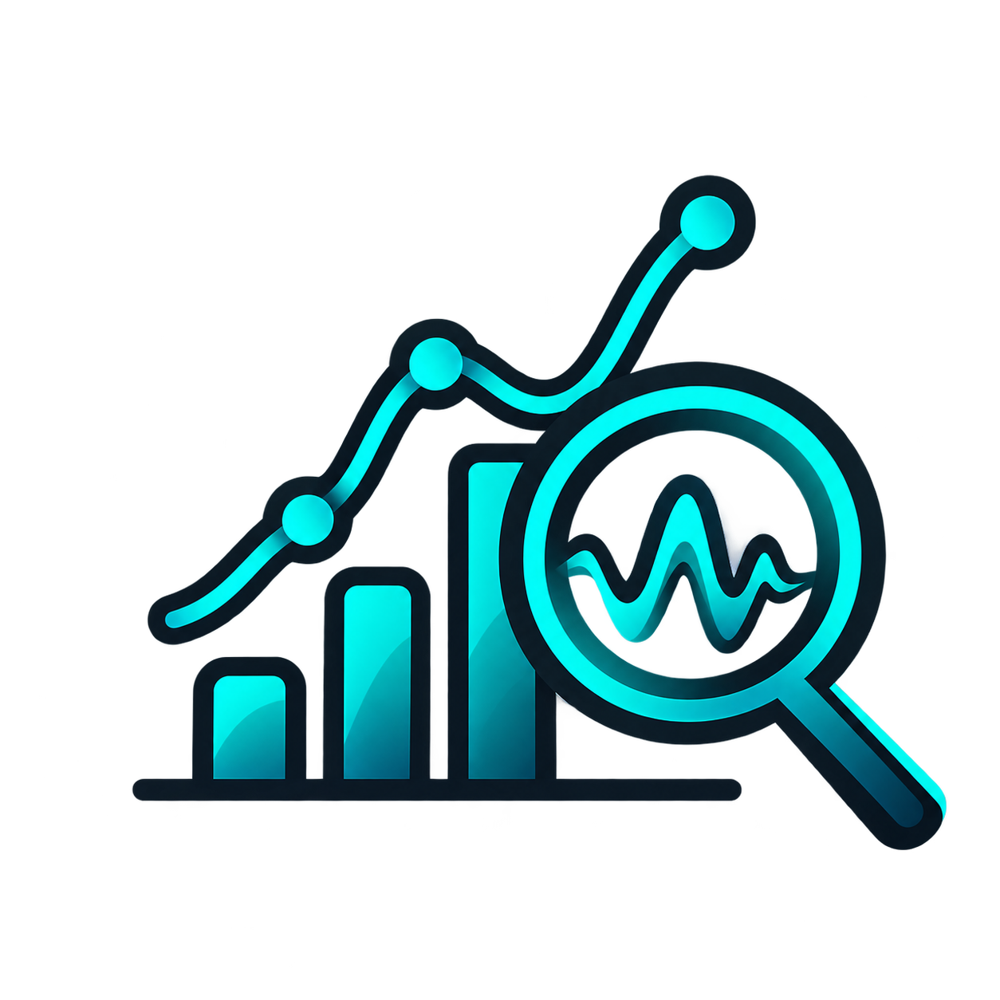
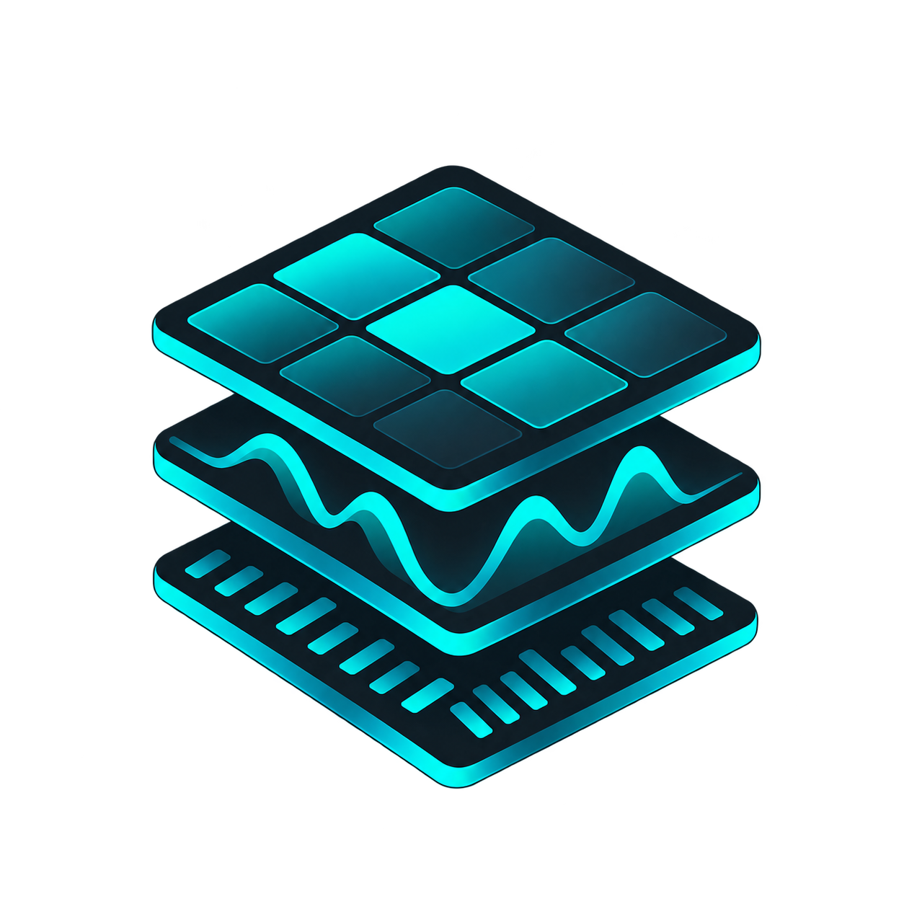
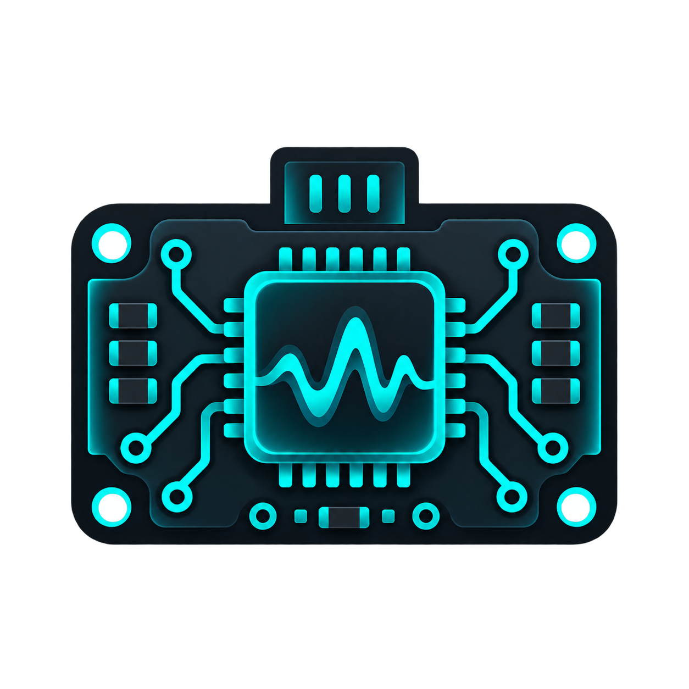

# Project Edgewake

**Small experiments. Uncertain futures. Useful engineering.**

*An independent engineering exploration of practical machine learning, artificial intelligence, and the systems surrounding them.*

---

## What is Edgewake?

Project Edgewake is my personal engineering workshop for exploring machine learning, artificial intelligence, and the technologies surrounding them.

I'm an experienced software and systems engineer with a background in C/C++, Python, embedded systems, industrial control, cybersecurity and electrical engineering. Machine learning, however, is a discipline I'm actively learning.

The intention isn't to pretend to be an AI researcher, build the next foundation model, or produce another wrapper around somebody else's API.

It's to become a better engineer by understanding the technology deeply enough to make informed decisions about it.

**What can a competent engineer achieve with practical machine learning, modest computing resources, and a willingness to experiment?**

Where does machine learning genuinely provide an advantage over traditional algorithms, statistics or established engineering methods? Where does it introduce unnecessary complexity? How do we measure the difference? And how much of the surrounding hype survives contact with actual engineering?

Those are the sorts of questions I want to investigate.

Edgewake is somewhere to experiment, learn, make mistakes, document discoveries and occasionally build something useful.

There isn't a grand architecture or predetermined destination. The project will evolve through the things I learn and the problems I find interesting.

The name reflects that uncertainty. We're standing at the edge of something significant, without necessarily understanding what comes next.

I'd rather investigate than blindly embrace or dismiss it.

---

## Engineering Philosophy

### Understanding Over Abstraction

**Using an abstraction shouldn't mean ignoring what happens underneath it.**

Modern machine-learning libraries provide extraordinary capabilities, and I fully intend to use them. But I want to understand the relevant algorithms, mathematics, training processes and engineering trade-offs rather than treating models as mysterious black boxes.

I don't need to write my own compiler to understand parsing, intermediate representations, optimisation and code generation. The same principle applies to machine learning.

*Use abstractions, understand them, and recognise their limitations.*

### Evidence Over Hype

**A more sophisticated model isn't automatically a better solution.**

Conventional algorithms, statistical methods and deterministic heuristics deserve comparison alongside machine learning. Experiments should begin with meaningful questions, sensible baselines and honest evaluation.

Negative results are legitimate findings. Sometimes discovering that a neural network provides no useful advantage is the most valuable outcome.

### Experimentation Before Infrastructure

**Start with a question. Build the smallest useful experiment. Measure what happens.**

Only introduce new abstractions, shared tooling or infrastructure when a demonstrated need justifies them.

I'm not trying to build a general-purpose machine-learning framework, another agent platform or an elaborate distributed training system.

*Professional engineering is appropriate design, not maximum complexity.*

### Modest Resources, Useful Outcomes

**Large models and expensive infrastructure aren't the only interesting applications of machine learning.**

I'm particularly interested in small, specialised models, ordinary hardware, constrained environments and applications where efficiency matters.

Smaller, faster, cheaper and more maintainable are meaningful engineering properties, provided the result remains useful.

An experiment that runs successfully on an ageing CPU might be more interesting than one requiring several expensive GPUs.

The objective isn't to avoid powerful hardware. It's to understand when we genuinely need it.

### Reproducibility and Intellectual Honesty

**A successful experiment should be understandable and repeatable. An unsuccessful experiment should be understandable too.**

Where practical, experiments should record their assumptions, configurations, dataset provenance, evaluation methods and limitations.

The point of documentation isn't to make everything look impressive. It's to capture what happened, what was learned and what remains uncertain.

---

## Areas of Exploration

These are areas of interest, not a formal roadmap or promises of future deliverables.

| | Area | Questions worth exploring |
|:---:|---|---|
|  | **Practical ML** | When do classical ML methods and compact neural networks outperform simpler approaches? |
|  | **Training & Optimisation** | How do training strategies, fine-tuning and optimisation affect outcomes? |
|  | **Dataset Engineering** | How do we generate, prepare, validate and understand useful datasets? |
|  | **Model Evaluation** | How do models generalise, fail, drift or respond to unfamiliar conditions? |
|  | **Constrained Compute** | What is practical on CPUs, older GPUs and low-memory hardware? |
|  | **Embedded & Industrial Systems** | Can ML help interpret telemetry, detect anomalies or improve engineering workflows? |
|  | **Practical Tooling** | Which experimental findings justify building reusable software? |

I'm especially interested in the boundary between conventional engineering and machine learning: places where signals, measurements, physical systems and software intersect.

There's room for unexpected ideas too. Not every experiment needs to be industrial, embedded or immediately useful. Some questions are worth exploring simply because they're interesting.

---

## Projects & Experiments

Edgewake is organised around independent pieces of engineering rather than a shared application framework. Each maintains its own documentation, dependencies and structure as appropriate.

| Experiments | Projects |
|:---:|:---:|
|  |  |
| **[Explore Experiments](experiments/README.md)** | **[Explore Projects](projects/README.md)** |
| Focused investigations into specific questions, including methodology, measurements, results and failures. | Independent tools, applications and more substantial engineering work that may emerge from useful ideas. |

---

## AI Usage & Authorship

It would be rather ironic to start a project exploring artificial intelligence and then refuse to use it.

AI tools are part of my engineering workflow, and I make no attempt to hide that.

I use them for discussing ideas, exploring unfamiliar concepts, reviewing approaches, explaining mathematics, challenging assumptions, and occasionally assisting with code, documentation and debugging.

The project's branding and visual assets have also been created with AI assistance.

However, Edgewake is deliberately a **human-led engineering project**, not an exercise in autonomous software development.

I'm not currently using an agentic development workflow to independently design and implement the project. My intention is to remain directly involved in the engineering decisions, implementation, experiments and evaluation.

This distinction matters particularly here.

I'm exploring machine learning because I want to understand it.

Generating an entire training pipeline without understanding the underlying mathematics, data transformations, model choices or evaluation would largely defeat that purpose.

AI can help me investigate a problem, but it shouldn't substitute for learning how to solve it.

The same engineering standards apply regardless of how code or ideas were produced:

- I remain responsible for the design, implementation and engineering decisions.
- Generated suggestions and code require understanding, review and appropriate testing.
- Experimental claims should be supported by measurements and reproducible evidence, not model-generated explanations.
- AI assistance does not establish the correctness of a result.
- Authorship, limitations and the provenance of relevant materials should be represented honestly.

My use of these tools will almost certainly evolve as my understanding develops. That evolution may itself become something worth exploring.

For now, the principle is simple:

**Use AI to accelerate understanding, not to replace it.**

---

## Project Status

**Early exploration — establishing the foundations.**

Edgewake is currently an engineering direction and a place to investigate ideas, not an established machine-learning platform or research laboratory.

There are no claims of completed research, demonstrated model performance or production-ready ML applications.

Experiments and projects will be added as they are undertaken, with their own documentation and results.

This top-level README is intended to remain relatively stable. Most technical progress, implementation details and findings will live alongside the work that produced them.

The direction will evolve as I learn.

---

## Licensing

The repository's original source code is licensed under the [MIT License](LICENSE), unless otherwise stated.

Datasets, pretrained models, model weights, third-party materials and visual assets may have separate licensing, usage or attribution requirements.

Refer to individual project and experiment documentation for any additional licensing or provenance information.

---

**Small experiments. Uncertain futures. Useful engineering.**

*Build something. Measure it. Understand it. Try again.*

