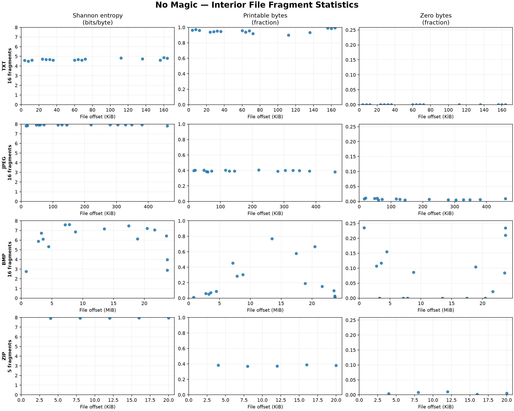
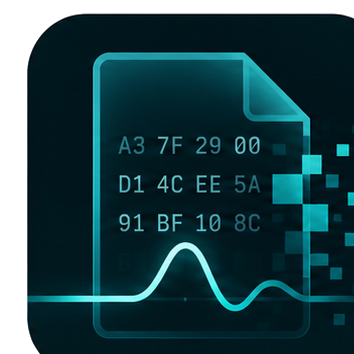

<div align="center">


# Result 001 — File Fragment Statistics

**No Magic · Experiment 001**

*Small experiments. Uncertain futures. Useful engineering.*


[← No Magic](../../README.md) · [← Project Edgewake](../../../../README.md)

</div>

---

## About

No Magic is an experiment exploring whether small, locally trained machine learning models can identify file formats from fragments of data without depending on file extensions or initial signatures.

Before attempting to train anything, it seemed sensible to look at the data.

What does a fragment of an ordinary text file actually look like statistically? How different is an uncompressed image from a compressed one? And can two entirely different file formats end up looking remarkably similar?

This first investigation attempts to answer those questions using three simple measurements.

There is no machine learning involved yet.

The objective is to establish a basic understanding of our data, find out what the measurements reveal, and identify where they might fall short.

## Question

**Can simple byte-level statistics reveal meaningful differences between file formats when examining fragments taken from inside files?**

More specifically, can we observe useful characteristics of TXT, JPEG, BMP and ZIP data using only 4 KiB fragments and without examining their initial file headers?

## Method

Four specimens were selected from the experiment dataset:

| Format | Specimen | Origin |
|---|---|---|
| TXT | `alice.txt` | Downloaded text |
| JPEG | `fronalpstock.jpg` | Downloaded photograph |
| BMP | `blue-marble.bmp` | Generated from a JPEG |
| ZIP | `mixed-content.zip` | Generated mixed-content archive |

All downloaded inputs are recorded in the [source manifest](../../data/sources.json), including provenance and SHA-256 checksums. Generated specimens are described in the [generation manifest](../../data/generation.json).

### Sampling configuration

| Parameter | Value |
|---|---|
| Fragment size | 4,096 bytes (4 KiB) |
| Maximum fragments per file | 16 |
| Sampling | Random selection of aligned, non-overlapping blocks |
| Random seed | 42 |
| Initial exclusion | First 4,096 bytes |
| Incomplete fragments | Excluded |
| Measurements | Entropy, printable-byte fraction, zero-byte fraction |

The first 4 KiB was excluded to avoid simply identifying files from their initial signatures and headers.

The remaining file was considered as a sequence of complete, aligned 4 KiB blocks. Up to sixteen blocks were selected using a deterministic random seed.

This resulted in **63 fragments** across the four specimens.

Importantly, skipping the first block does not guarantee that all other format-specific structures have been removed. Internal headers, compressed data structures and other identifying characteristics may still be present.

## Why these measurements?

Statistical classification of file fragments has been explored previously, particularly in digital forensics and file carving.

Veenman (2007) investigated identifying disk-cluster types through statistical features rather than relying entirely on embedded file signatures. Calhoun and Coles (2008) explored predicting file-fragment types using statistical and sequence-based approaches.

These provide useful context, but this investigation is deliberately simpler.

The three measurements were chosen because they are inexpensive to calculate, straightforward to understand, and provide different views of the same bytes.

### 1. Shannon entropy

Shannon entropy measures uncertainty within a probability distribution. The underlying concept was formalised by Claude Shannon in 1948.

For our fragments, entropy is calculated from the observed frequencies of the 256 possible byte values:

$$
H(X) = -\sum_{x=0}^{255} p(x)\log_2 p(x)
$$

where $p(x)$ is the proportion of bytes having value $x$. Values with zero probability contribute zero to the sum.

The resulting value ranges from 0 to 8 bits per byte.

**Why choose it?**

Different kinds of data can exhibit different degrees of redundancy.

Natural-language text tends to use some byte values much more frequently than others. Compressed content often has a more uniform distribution of byte values.

Entropy provides a simple way to investigate that difference.

However, high entropy does not establish that something is compressed, encrypted or random. It also ignores the order in which byte values occur.

Two fragments containing the same number of each byte value will have identical measured entropy, even if their arrangements are completely different.

Reference: [Shannon, 1948](https://doi.org/10.1002/j.1538-7305.1948.tb01338.x).

### 2. Printable-byte fraction

This measures the proportion of bytes representing printable ASCII characters, including common text whitespace.

The accepted values are:

- `0x20`–`0x7E` — printable ASCII characters
- `0x09` — tab
- `0x0A` — line feed
- `0x0D` — carriage return

$$
P_{\text{printable}} = \frac{\text{matching bytes}}{\text{total bytes}}
$$

**Why choose it?**

Ordinary text tends to contain a high proportion of these characters, while binary formats may contain a wider range of byte values.

ASCII character frequencies have also been investigated as features in file-fragment classification research.

It is a particularly straightforward measurement and may help distinguish text-like content from some forms of binary data.

However, printable bytes also occur in binary data by chance, and not all text uses ASCII-compatible encodings.

For reference, a perfectly uniform distribution across all 256 byte values would produce an expected printable fraction of approximately **38.28%** using our definition.

Reference: [Calhoun and Coles, 2008](https://doi.org/10.1016/j.diin.2008.05.005).

### 3. Zero-byte fraction

This measures the proportion of bytes containing the value `0x00`.

$$
P_{\text{zero}} = \frac{\text{number of zero bytes}}{\text{total bytes}}
$$

**Why choose it?**

Some binary data contains repeated zero values arising from padding, structure or the data itself.

Measuring their frequency is simple and may reveal differences that are not immediately apparent from entropy alone.

For example, an uncompressed image containing large areas of low-valued pixels may contain more zero bytes than a compressed representation of the same image.

This is an exploratory heuristic rather than a claim that zero-byte frequency is a proven independent predictor of file format.

Its usefulness remains something to investigate.

## Results



*Figure 1 — Statistical characteristics of sampled interior file fragments. Each row represents one file format, with Shannon entropy, printable-byte fraction and zero-byte fraction plotted against file offset. Points represent individual measurements; the intervening regions were not sampled.*

The complete set of measurements is available in [001-fragment-statistics.csv](data/001-fragment-statistics.csv).

The CSV records individual observations, including source identifiers, specimen hashes, fragment offsets, sampling settings and measured values.

### Summary

| Format | Fragments | Mean entropy (bits/byte) | Mean printable | Mean zero |
|---|---:|---:|---:|---:|
| TXT | 16 | 4.6770 | 95.37% | 0.00% |
| JPEG | 16 | 7.9021 | 39.53% | 0.72% |
| BMP | 16 | 6.0777 | 23.79% | 8.47% |
| ZIP | 5 | 7.9410 | 37.87% | 0.58% |

These are descriptive statistics from four individual files. They should not be interpreted as representative estimates for entire file-format populations.

## Observations

### TXT — A relatively distinctive result

The text specimen exhibited consistently low entropy compared with JPEG and ZIP.

Its average entropy was 4.6770 bits per byte, with approximately 95% of sampled bytes falling within the defined printable range.

No zero bytes were observed.

This is consistent with what we might expect from ordinary English prose. Its byte values are not distributed uniformly, and most correspond to printable characters.

Within this small sample, the text fragments appear relatively easy to distinguish from the compressed specimens using these measurements.

Whether that remains true across different text encodings, languages and other types of text remains unanswered.

### JPEG — High entropy and relatively consistent measurements

The JPEG specimen exhibited consistently high entropy, averaging 7.9021 bits per byte.

Printable-byte fractions remained close to 40%, while zero-byte fractions were generally low.

There was comparatively little variation across the sampled regions.

This is consistent with examining predominantly compressed image data.

However, these characteristics are not necessarily unique to JPEG. Other compressed formats may exhibit similar distributions.

### BMP — Considerable variation within a single file

The BMP produced the most varied results of the four specimens.

Its sampled entropy ranged from **2.7686 to 7.6062 bits per byte**, despite every fragment originating from the same file.

Printable-byte and zero-byte fractions also varied substantially.

The underlying image contains regions with very different visual characteristics, including comparatively uniform areas and more complex detail.

Because BMP stores uncompressed pixel values in this case, such variation may be reflected directly in the bytes being measured.

This presents an interesting difficulty for fragment classification.

A fragment taken from one region of an image can look statistically very different from a fragment taken elsewhere in that same image.

**Knowing the format does not mean we know what its individual fragments will look like.**

### ZIP — Surprisingly similar to JPEG

The ZIP specimen produced the highest average entropy of the four files at 7.9410 bits per byte.

Its mean printable-byte fraction was 37.87%, compared with 39.53% for JPEG.

Both results are close to the 38.28% printable fraction expected from a uniform byte distribution.

This is interesting because JPEG and ZIP are quite different formats, but both contain compressed data.

Our simple measurements appear to capture some common statistical characteristics of their compressed payloads rather than features that uniquely identify their file formats.

There is an important qualification: the ZIP specimen contributed only five eligible fragments.

We cannot conclude that ZIP files are inherently more statistically consistent, or that ZIP and JPEG are generally indistinguishable, from this result.

## Discussion

The results suggest three things.

**First, relatively simple statistics can reveal meaningful differences.**

The TXT specimen appears distinctly different from JPEG and ZIP. We did not need machine learning to observe that separation.

**Second, variation within a format matters.**

The BMP demonstrates substantial changes in statistical characteristics across one file. This suggests that content may strongly influence what a fragment looks like, regardless of its file format.

**Third, different formats can share similar characteristics.**

JPEG and ZIP were remarkably close according to our measurements. Entropy and simple byte fractions alone may not provide enough information to distinguish some compressed data reliably.

This raises a more interesting question than simply whether the four formats have different average entropy values.

**What information is missing from these measurements that might allow us to distinguish statistically similar fragments?**

Possibilities include relationships between neighbouring bytes, local patterns and other structural characteristics.

Those are questions for later investigations. We have not established which additional features, if any, will be useful.

## Limitations

This is an initial exploratory investigation with a very small dataset.

Several limitations are important:

1. **Only one file per format was examined.** Results may reflect individual file content rather than general format characteristics.
2. **The sample counts are unequal.** The ZIP specimen contained only five eligible fragments.
3. **The samples are aligned.** Fragments at arbitrary offsets may behave differently.
4. **Internal signatures remain possible.** Excluding the first block does not eliminate every format-specific structure.
5. **Only three measurements were used.** All are based on individual byte values rather than longer-range relationships.
6. **Fragments from the same file are related.** They must not be treated as independent source files during future model evaluation.

No classifier was trained, and no classification accuracy was measured.

The results demonstrate observable statistical behaviour in the selected specimens, not reliable generalisation to unseen files.

## Reproduction

The investigation uses the existing source acquisition, sample generation and fragment analysis utilities.

From the `experiments/001-no-magic/` directory, with the Python virtual environment activated, install the project dependencies:

```powershell
python -m pip install -e .
```

Run the investigation using previously prepared files:

```powershell
python -m scripts.investigations.result_001
```

Alternatively, prepare and verify the source material before running the investigation:

```powershell
python -m scripts.investigations.result_001 --prepare
```

The second command uses the existing downloader and generation pipeline, including pinned source checksum verification and generated-output comparison.

The investigation produces:

| Artefact | Purpose |
|---|---|
| [Measurements CSV](data/001-fragment-statistics.csv) | Individual statistical observations and provenance |
| [Statistics figure](figures/001-fragment-statistics.png) | Visual presentation of the measurements |

Relevant implementation:

- [Investigation runner](../../scripts/investigations/result_001.py)
- [Statistical analysis](../../scripts/analysis/fragment_statistics.py)
- [Fragment extraction](../../scripts/dataset/fragments.py)
- [Source manifest](../../data/sources.json)
- [Generation manifest](../../data/generation.json)

The sampling seed, specimen identities and source checksums support reproducibility. Exact PNG rendering may vary between plotting-library versions and environments.

## Conclusion

The first investigation has produced an interesting, if unsurprising, result.

Simple byte-level statistics can reveal meaningful differences between fragments of the files we examined, but those differences are neither uniform nor necessarily unique to a particular format.

The text specimen was relatively distinctive. The BMP varied dramatically across its contents. JPEG and ZIP exhibited remarkably similar statistical characteristics.

That gives us a useful starting point.

We have not demonstrated that these three measurements can reliably identify arbitrary file fragments. What we have demonstrated is that there are observable characteristics worth investigating, along with some immediate reasons to question how useful they will be for classification.

For an experiment called **No Magic**, that feels like an appropriate first result.

## What Comes Next?

This initial investigation examined 63 fragments drawn from just four individual source files. While the measurements reveal some interesting differences between the selected formats, they do not establish whether those differences are representative of the formats more generally.

That leaves an important question:

**Do these statistical patterns persist across independent files of each format, or are we primarily observing characteristics of the particular specimens we selected?**

Before attempting classification, we need a dataset capable of investigating that question meaningfully.

**Result 002 — Dataset Design and Construction** will examine how we select representative source files, justify dataset size and diversity, account for dependencies between samples, and establish reproducible sampling procedures.

The objective is not simply to collect more fragments, but to understand what constitutes sufficient evidence for the experiments that follow.

## References

1. Shannon, C. E. (1948). *A Mathematical Theory of Communication*. Bell System Technical Journal, 27(3), 379–423. [DOI](https://doi.org/10.1002/j.1538-7305.1948.tb01338.x)
2. Veenman, C. J. (2007). *Statistical Disk Cluster Classification for File Carving*. International Workshop on Computational Forensics. [DOI](https://doi.org/10.1109/IAS.2007.75)
3. Calhoun, W. C., & Coles, D. (2008). *Predicting the Types of File Fragments*. Digital Investigation, 5(Supplement), S14–S20. [DOI](https://doi.org/10.1016/j.diin.2008.05.005)
4. Cerf, V. G. (1969). *ASCII Format for Network Interchange*. RFC 20. [RFC Editor](https://www.rfc-editor.org/info/rfc20/)

---

<div align="center">



**No Magic · Project Edgewake**

*Ask questions. Measure things. Learn something.*

[↑ Back to No Magic](../../README.md)

</div>