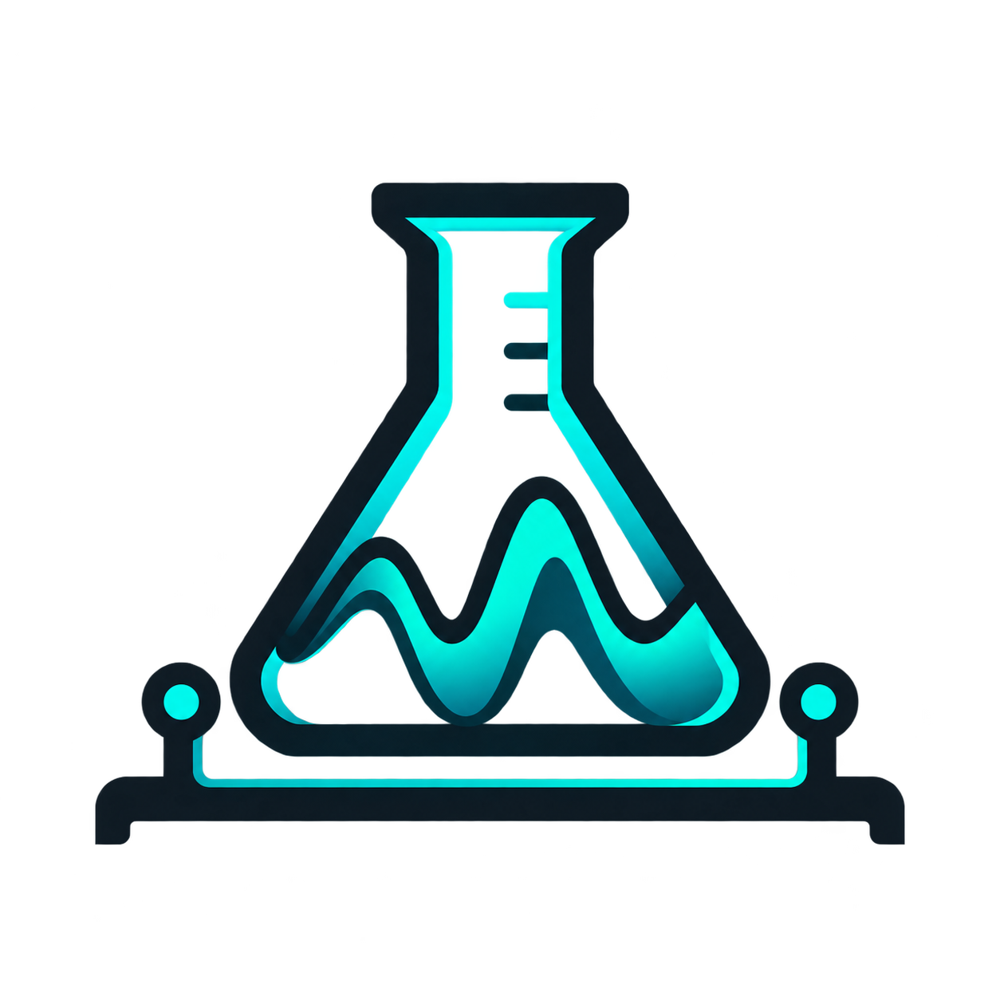
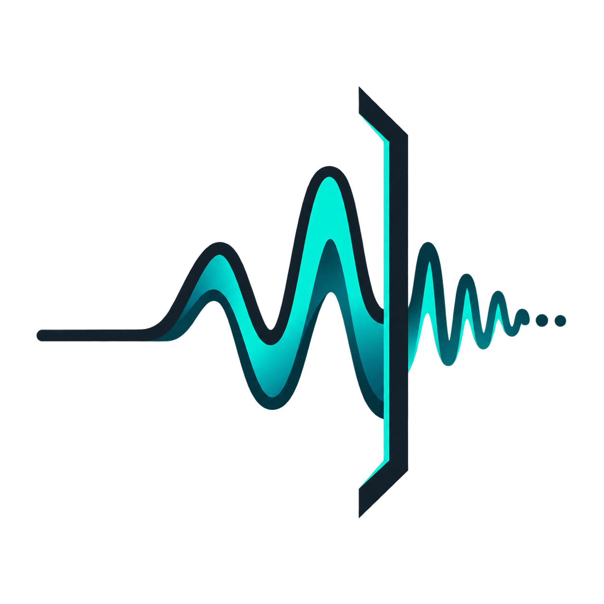

# Edgewake Experiments

**Ask questions. Measure things. Learn something.**

[← Project Edgewake](../README.md)

---

## About

This is where the experimental work happens.

Each experiment begins with a question worth investigating. It might concern model behaviour, dataset quality, training strategies, optimisation, hardware limitations, or whether machine learning is even the appropriate solution to a particular problem.

The objective isn't necessarily to produce a useful model or an impressive result.

It's to understand something a little better.

Experiments should be reasonably self-contained, with enough information to understand what was attempted, why, how it was measured, and what happened.

A negative result isn't a failed project. Sometimes it's exactly the answer we needed.

## Experiment Index

| | Experiment | Investigation | Status |
|:---:|---|---|:---:|
|  | **[001 — No Magic](001-no-magic/README.md)** | Identifying file formats from arbitrary binary fragments using statistics, classical ML and small neural networks. | Proposed |

As investigations are undertaken, they will be listed here with links to their own documentation, methodology and findings.

---

**Small experiments. Uncertain futures. Useful engineering.**

[← Back to Project Edgewake](../README.md)

